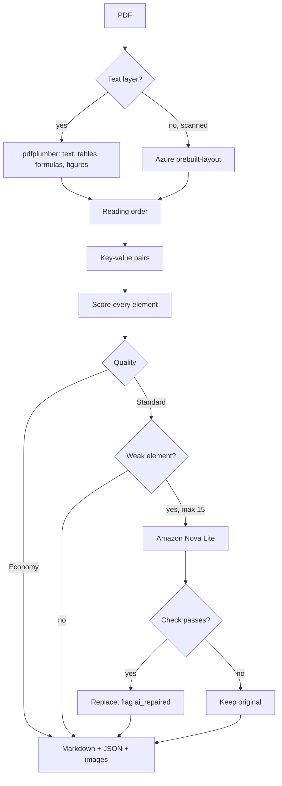

# Pagewise: Unstructured Data Ingestion Pipeline

Pagewise turns a PDF into Markdown, JSON and image files. It reads the PDF with code first, scores every element, and uses AI only on the few elements it distrusts. This repo holds Scope 1 (the tool-comparison prototype) and Scope 2 (Pagewise, the production service).

- Live app: `<https://unstructured-data-ingestion-pipeline-agwzsbtb3xtfdvpuc9d7k6.streamlit.app/>`
- Live API: `<https://dashboard.render.com/web/srv-dava1359fdbs73bfkuqg>` (docs at `/docs`)
- Benchmark: [docs/BENCHMARK.md](docs/BENCHMARK.md) | Terraform: [infra/README.md](infra/README.md)

> **AI repair works only locally.** My AWS keys are temporary, so the live app runs Economy. Standard (with AI) runs on a laptop with valid keys.

## Features

- Headings, text, tables, formulas (as LaTeX), key-value pairs and images, in reading order
- A confidence score and the source on every element
- Two quality levels: **Economy** (code only) and **Standard** (adds AI repair of weak tables and formulas)
- Scanned pages read by Azure
- Source vs output view: amber marks low confidence, blue marks AI-repaired
- Cost and time cards, a Compare tools tab, and a Download-all zip
- API with keys, jobs, results and usage; queue and worker so big files never time out
- In Standard, the app shows how many elements went to AI, how many were fixed, how many were rejected, and the AI cost

## Engine architecture

Weak means a table below 0.8 or text/formula below 0.6. An AI answer is kept only if the table score rises or the formula is valid LaTeX that renders. A second AI call then compares the answer with the page, and a wrong answer is rejected.

## What works where

| Capability | Live app (Render + Streamlit Cloud) | On my laptop |
|---|---|---|
| Economy extraction | Yes | Yes |
| Scanned pages through Azure | Yes, if the Azure key
