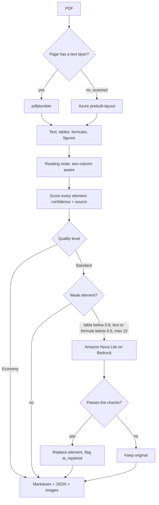

# Pagewise: Unstructured Data Ingestion Pipeline

This repo holds both scopes. **Scope 1** is the extraction prototype (several tools side by side). **Scope 2** is **Pagewise**, a PDF extraction service built on top of it. Pagewise reads a PDF with code first, scores every element, and uses AI only on the few elements it distrusts. It returns Markdown, JSON with a confidence per element, and the document's images.

- Live app (Streamlit): `<add your Streamlit link>`
- Live API (Render): `<add your Render URL>` (docs at `/docs`)
- Benchmark report: [docs/BENCHMARK.md](docs/BENCHMARK.md)
- Deploy as code: [infra/README.md](infra/README.md)

## Features

- **Six element types** in reading order: headings, text, tables, formulas (as LaTeX), key-value pairs, and images (saved as files, linked from the Markdown)
- **Two-column layouts** read in the right order
- **Scanned pages** (no text layer) go to Azure `prebuilt-layout`
- **Confidence and source** on every element, so weak parts are visible
- **Two quality levels:** Economy (code only) and Standard (adds AI repair)
- **AI repair** only on weak elements, with every answer checked before it replaces anything. Repaired elements are flagged `ai_repaired`
- **App:** upload a PDF, view Markdown, JSON and images, see the PDF page next to the output (amber = low confidence, blue = AI-repaired), cost and time cards, a Compare tools tab, and a Download-all zip
- **API (`/v1`):** API keys, submit a PDF or link, check job status, get Markdown or JSON, cost per job, usage report
- **Queue and worker** so large files never hold a request open; Terraform for the AWS setup (validated, not deployed)

## New in Scope 2

Confidence and source per element, AI repair with a check, formulas as LaTeX, figures as image files, Azure for scanned pages, the product API, the source-vs-output view, cost and time cards, a benchmark against other tools, and Terraform.

## Engine architecture



An AI answer replaces the original only if it passes two checks. A table must score higher than the original (formulas must be valid LaTeX that renders), and then a second AI call compares the answer with the page.

## What works where

| Capability | Live app (Render + Streamlit Cloud) | On my laptop |
|---|---|---|
| Economy extraction | Yes | Yes |
| Scanned pages through Azure | Yes, if the Azure key is set | Yes |
| **Standard: AI repair (Amazon Nova Lite)** | **No. My AWS keys are temporary, so the live app runs Economy** | **Yes, with valid AWS keys** |
| Docling in Compare tools | No (runs locally) | Yes |
| Textract in Compare tools | Not run (needs a paid AWS plan) | Not run |

The live app runs on a free server with limited memory, so PDFs up to about 1 MB (around 20 pages) work best there. Larger files and AI repair run locally.

## Run it locally (PowerShell)

```
# 1. install (once)
python -m venv venv
venv\Scripts\activate
pip install -r requirements.txt

# 2. terminal 1: the API
uvicorn api.main:app --reload

# 3. terminal 2: the app
$env:API_URL="http://localhost:8000"
streamlit run app.py
```

Copy `.env.example` to `.env` and fill in your keys. Never commit `.env`.

| Variable | Purpose |
|---|---|
| `API_KEY_PEPPER` | Secret used to hash API keys |
| `AI_REPAIR_ENABLED` | Set to `true` to make AI calls at Standard |
| `BEDROCK_AWS_ACCESS_KEY_ID`, `BEDROCK_AWS_SECRET_ACCESS_KEY`, `BEDROCK_AWS_SESSION_TOKEN` | Credentials used only for the AI model |
| `BEDROCK_REGION`, `BEDROCK_MODEL_ID` | Default `us-east-1` and `amazon.nova-lite-v1:0` |
| `AZURE_DOCINTEL_ENDPOINT`, `AZURE_DOCINTEL_KEY` | Azure OCR for scanned pages |
| `API_URL` | Where the Streamlit app finds the API |

Tests: `pytest tests`

## API

Every route except `POST /v1/keys` needs the header `X-API-Key`.

| Route | What it does |
|---|---|
| `POST /v1/keys` | Create an API key (shown once) |
| `POST /v1/jobs` | Send a PDF or link and a `quality`; get a job id at once |
| `GET /v1/jobs/{id}` | Status, pages and cost |
| `GET /v1/jobs/{id}/result` | Markdown or JSON (`?format=json`) |
| `GET /v1/usage` | Usage and cost per day |

Limits: 25 MB per upload and 60 pages per document.

## Results

On ACE.pdf (19 pages, 13 tables, many formulas), Pagewise found all 13 tables, 62 formulas as LaTeX and 28 headings. The other tools found no formulas and no image links. Raw text recall is lower (92% against 98% for MarkItDown and 100% for pdfplumber), because the engine turns garbled math into LaTeX and figure labels into images.

**AI repair on ACE.pdf:** 13 weak elements were sent to Amazon Nova Lite. In my first run 10 were repaired. In later runs 6 were repaired and 7 rejected by the checks, so the original text stayed. The cost was about $0.004 for 19 pages. I also tested Nova Pro, which repaired none and cost about 14 times more, and the Claude models were blocked on my AWS account. Details are in the [benchmark report](docs/BENCHMARK.md).

## Cost per 1,000 pages

| Option | Cost |
|---|---|
| Pagewise Economy | about $0.02 |
| Pagewise Standard | about $0.17 (math-heavy paper), $0.02 (clean paper) |
| Pagewise, scanned pages | about $10 (Azure) |
| Textract, text only / with tables | $1.50 / $15 |

Economy is about 0.5 to 1.3 seconds per page (measured on text PDFs). Prices come from third-party pages, so confirm them before quoting a customer.

## Known limits

- PDF only. Output is Markdown, JSON and image files.
- **AI repair works only locally.** The AWS keys are temporary, so the live app runs Economy.
- The live app handles small PDFs best (free server memory). The engine accepts up to 25 MB and 60 pages.
- The AI checks look at structure and compare with the page, but a clean wrong answer can still pass. Repaired elements are flagged for review.
- Key-value extraction is built but not tested on a real invoice or form.
- Scanned-page time has not been measured.
- Terraform is validated, not deployed.
- Docling and Textract are not in the live app.
