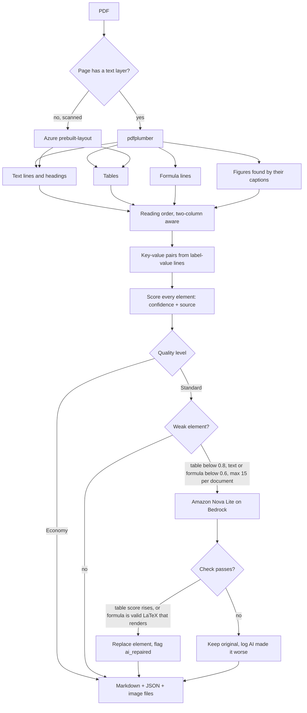
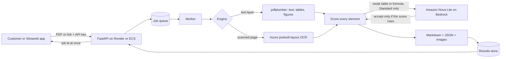

# Unstructured Data Ingestion Pipeline: Pagewise

This repository holds both scopes of the challenge. **Scope 1** is the extraction prototype (several tools side by side). **Scope 2** is **Pagewise**, the production extraction service built on top of it.

Pagewise is a PDF extraction service. It reads a PDF with code first, scores every element it extracts, and uses AI only on the few elements it distrusts. It returns Markdown, structured JSON with a confidence per element, and the document's images as files.

- Live app (Streamlit): `<https://unstructured-data-ingestion-pipeline-agwzsbtb3xtfdvpuc9d7k6.streamlit.app/>`
- Live API (Render): `<https://dashboard.render.com/web/srv-dava1359fdbs73bfkuqg>` (docs at `/docs`)
- Benchmark report: [docs/BENCHMARK.md](docs/BENCHMARK.md)
- Deploy as code: [infra/README.md](infra/README.md)

## What it does

| Element | How it comes out |
|---|---|
| Headings | `#` headings, in reading order |
| Text | Paragraphs, two-column layouts read in the right order |
| Tables | Markdown tables |
| Formulas | LaTeX between `$$ ... $$` |
| Key-value pairs | Bold labels, built from label-value lines |
| Images and figures | Saved as separate files, linked from the Markdown, with the caption kept |

Every element carries a **confidence** (0 to 1), the **source** that produced it, and flags such as `ai_repaired`.

### Two quality levels

| Level | What runs | AI calls | Cost per 1,000 pages |
|---|---|---|---|
| **Economy** | Code only, plus Azure OCR for scanned pages | None | about $0.02 (server time) |
| **Standard** | Economy, then AI repair of weak tables and formulas | Only for weak elements, at most 15 per document | about $0.17 on a math-heavy paper, $0.02 on a clean one |

Scanned pages cost about $10 per 1,000 at either level because they go to Azure.

**AI repair works only locally for now.** The AWS keys for Bedrock are temporary, so the live app runs Economy. Standard with AI runs on a laptop with valid keys.

## Features

**Extraction**
- Headings, text, tables, formulas, key-value pairs and images, all in reading order
- Two-column layouts read in the right order
- Formulas come out as LaTeX instead of garbled letters
- Figures are found by their captions and saved as separate image files, linked from the Markdown
- Scanned pages (no text layer) go to Azure `prebuilt-layout`
- Output as Markdown, JSON, and image files, with a Download-all zip

**Quality and trust**
- A confidence score (0 to 1) and the source on every element
- Two quality levels: Economy (code only) and Standard (adds AI repair)
- AI repair only on weak elements: tables below 0.8, text and formulas below 0.6, at most 15 per document
- Every AI answer is checked and rejected if it does not improve the element
- Repaired elements are flagged `ai_repaired` so a person can review them

**App (Streamlit)**
- Upload a PDF and pick a quality level
- Markdown, JSON and images tabs
- Source vs output view: the PDF page next to the result, amber for low confidence, blue for AI-repaired, with a confidence slider
- Cost and time cards for each run
- Compare tools tab: Pagewise against pdfplumber, MarkItDown and Docling on the same PDF

**API (`/v1`)**
- Self-service API keys, stored only as hashes
- Submit a PDF or a public link and get a job id at once; poll status; fetch the result as Markdown or JSON
- Per-job cost and a per-day usage report
- Limits: 25 MB per upload, 60 pages per document, 10 new keys an hour per address

**Running it**
- Queue and worker, so large files never time out; failed jobs retry three times, then go to a dead-letter queue
- Local backend (a thread queue, no cloud account needed), or AWS backend (queue and S3, created by Terraform)
- Terraform for the AWS setup (validated, not deployed)
- Tests for keys, jobs, status, usage, cost and the AWS path

## New in Scope 2

- Confidence and source on every element, so weak parts are visible
- AI repair of weak tables and formulas, with a check and a review flag (Scope 1's main failures were tables with weak scores)
- Formulas as LaTeX and figures saved as image files
- Scanned pages read by Azure
- Key-value pairs as an element type (built, not yet scored on a real invoice)
- Product API: keys, jobs, status, results, usage and cost per job, with limits
- Queue and worker, local and AWS backends, Terraform, tests
- Source vs output view with low-confidence and AI-repaired elements marked
- Cost and time cards, and a benchmark against pdfplumber, MarkItDown and Docling

## What works where

| Capability | Live app (Render + Streamlit Cloud) | On my laptop |
|---|---|---|
| Economy extraction (text, tables, formulas, figures, key-values) | Yes | Yes |
| Scanned pages through Azure | Yes, if the Azure key is set in Render | Yes |
| **Standard: AI repair with Amazon Nova Lite** | **No. My AWS keys are temporary, so the live app runs Economy** | **Yes, with valid AWS keys** |
| Docling in Compare tools | No (heavy, open source, runs locally) | Yes |
| Textract in Compare tools | Not run (needs a paid AWS plan) | Not run |
| Source vs output view, cost and time cards, Download-all zip | Yes | Yes |
| API with keys, jobs, usage | Yes (local backend) | Yes (local or AWS backend) |
| AWS backend via Terraform | Not deployed | Validated, not deployed |

In short: the live app is fully usable but runs Economy. To see AI repair, run the app locally with valid Bedrock credentials and `AI_REPAIR_ENABLED=true`.

## Scope 1: the prototype

Scope 1 compared extraction tools on the same documents and stored the results.

- **Extraction:** pypdf and pdfplumber for PDFs, BeautifulSoup for web pages.
- **Standardising:** MarkItDown and Docling turn the output into Markdown.
- **Enterprise comparison:** AWS Textract was planned, but it needs a paid AWS plan, so it was not run.
- **Storage:** AWS S3.
- **App:** FastAPI backend and Streamlit front end, deployed on Render and Streamlit Cloud.
- **Docling** runs only locally; the live app offers the other tools.
- **What failed:** the elements the Scope 1 tools got wrong were mostly tables, with weak scores. This is what Scope 2 set out to fix.

## Engine architecture

The engine (`engine/`) turns one PDF into a list of elements. Each element has a type, a page, its content, a confidence, the source that made it, and flags.



What each stage does:

1. **Read.** pdfplumber reads every page that has a text layer: text with its position, tables, and the regions around figure captions. A page with no text layer goes to Azure `prebuilt-layout` instead.
2. **Build elements.** Lines become headings or text. Tables become Markdown tables. Lines that look like math are marked as formulas. Figures are cut out of the page by their captions and saved as image files.
3. **Reading order.** Elements are sorted by page and position, and two-column pages are read column by column.
4. **Key-value pairs.** Label-value lines (for example "Invoice No: 123") are grouped into key-value elements.
5. **Score.** Every element gets a confidence from 0 to 1 and the name of the source that produced it.
6. **Repair (Standard only).** Tables below 0.8 and text or formulas below 0.6 are sent to Amazon Nova Lite, at most 15 per document. A table is accepted only if its score rises. A formula is accepted only if it is valid LaTeX that renders. Otherwise the original stays.
7. **Output.** The elements are written as Markdown, JSON and image files. The report lists every repair and every rejected answer.

## System architecture



How the pieces fit:

1. **API** (`api/main.py`, `api/products.py`): checks the API key, accepts a PDF or a public link, answers at once with a job id, and serves status, results and usage. Large files never time out because the work happens in the worker.
2. **Queue and worker** (`engine/jobs.py`, `engine/worker.py`): the worker takes one job at a time from the queue and runs the engine. Several workers run side by side; a job that crashes returns to the queue and, after three tries, goes to a dead-letter queue.
3. **Engine** (`engine/`): reads text and tables with pdfplumber, finds figures by their captions, sends pages with no text layer to Azure, scores each element, and at Standard asks the AI to repair only the weak ones. An AI answer replaces the original only if it scores higher; otherwise the original stays and the report logs "AI made it worse".
4. **Storage:** two backends. Local (a thread queue) needs no cloud account and is what the free live deployment uses. AWS (queue and S3) is created by Terraform.
5. **Front end** (`app.py`): upload a PDF, view Markdown, JSON and images, compare tools, see the source page next to the output with low-confidence elements marked in amber and AI-repaired ones in blue.

### Why these choices

- **Code first, AI second.** Code is cheap and repeatable. AI is spent only where the engine reports low confidence, so cost follows the number of weak elements, not the number of pages.
- **Every AI answer is checked.** Tables are re-scored with the same function as the original. Formulas must be valid LaTeX that renders. The benchmark report shows both the repairs and the rejections.
- **Two backends.** The live demo must not depend on temporary AWS keys, so the local backend runs everywhere and the AWS backend is switched on by environment variables.
- **Evidence:** see [docs/BENCHMARK.md](docs/BENCHMARK.md) for baseline against engine per element type.

## Setup

### Prerequisites

Python 3.11 or newer, Git. For AI repair: an AWS account with Amazon Nova Lite enabled in Bedrock (us-east-1). For scanned pages: an Azure Document Intelligence resource. Both are optional; Economy on text PDFs needs neither.

### Install

```
git clone <your repo url>
cd <repo folder>
python -m venv .venv
.venv\Scripts\activate          (Windows)   or   source .venv/bin/activate   (Mac, Linux)
pip install -r requirements.txt
```

### Environment variables

Copy `.env.example` to `.env` and fill in what you need. Never commit `.env`; only `.env.example` is in Git.

| Variable | Purpose |
|---|---|
| `API_KEY_PEPPER` | Secret used to hash API keys. Set a long random value. |
| `BEDROCK_AWS_ACCESS_KEY_ID`, `BEDROCK_AWS_SECRET_ACCESS_KEY`, `BEDROCK_AWS_SESSION_TOKEN` | Credentials used only for the AI model |
| `BEDROCK_REGION`, `BEDROCK_MODEL_ID` | Default `us-east-1` and `amazon.nova-lite-v1:0` |
| `AZURE_DOCINTEL_ENDPOINT`, `AZURE_DOCINTEL_KEY` | Azure OCR for scanned pages |
| `AI_REPAIR_ENABLED`, `AI_REPAIR_MAX_ELEMENTS` | `AI_REPAIR_ENABLED` is off by default; set it to `true` for Standard to make AI calls (without it Standard runs as Economy and adds a warning). Cap per document defaults to 15. |
| `MAX_UPLOAD_MB`, `OCR_PRICE_PER_PAGE` | Upload limit in MB (25), OCR price per page (0.01) |
| `SIGNUP_OPEN`, `ADMIN_TOKEN` | Set `SIGNUP_OPEN=false` to make key creation need the `X-Admin-Token` header |
| `DATA_DIR` | Where the local backend keeps its data |
| `S3_BUCKET`, `JOBS_QUEUE_URL` and the other AWS names in `infra/` | Set to switch to the AWS backend (Terraform sets them) |
| `API_URL` | Used by the Streamlit app to find the API |

### Run locally

```
uvicorn api.main:app --reload            # API on http://127.0.0.1:8000, docs at /docs
streamlit run app.py                     # app on http://localhost:8501
```

`app.py` and `api/main.py` are the full version with AI repair. The live deployment uses the versions that force Economy quality, so it needs no AWS keys.

### Tests

```
pytest tests
```

Covers keys, jobs, status, usage, cost and the AWS path (with a mocked AWS).

### Deploy

**Free live demo:** API on Render, app on Streamlit Community Cloud. Set `API_KEY_PEPPER` in Render and `API_URL` in Streamlit.

**Production on AWS:** Terraform creates the API, workers, queue, bucket, secrets and monitoring. One command deploys and one removes everything. See [infra/README.md](infra/README.md). The configuration passes `terraform validate`; it has not been deployed to an account.

## API reference

Every route except `POST /v1/keys` needs the header `X-API-Key: <your key>`. Interactive docs are at `/docs`.

| Method and path | What it does |
|---|---|
| `POST /v1/keys` | Form field `label`. Returns a new API key, shown once. Limited to 10 new keys an hour per address. |
| `POST /v1/jobs` | Form fields: `file` (PDF) or `url`, and `quality` (`economy` or `standard`). Returns 202 with a job id and status `queued`. |
| `GET /v1/jobs/{id}` | Status, quality, time, pages and cost of the job |
| `GET /v1/jobs` | Your latest jobs (`?limit=`, up to 100) |
| `GET /v1/jobs/{id}/result` | `?format=markdown` (default) or `json`. 409 while unfinished, 422 if the job failed. |
| `GET /v1/jobs/{id}/source` | The PDF you sent, for the side-by-side view |
| `GET /v1/usage` | Jobs, pages, seconds and cost per day for your key |

Errors: 401 missing or invalid key, 404 unknown job (also for another user's job), 413 file too large, 429 too many key requests, 400 bad input.

### Example (PowerShell; on Mac or Linux use `curl`)

```
# 1. get a key
curl.exe -X POST https://<api-url>/v1/keys -F "label=my test"

# 2. submit a PDF
curl.exe -X POST https://<api-url>/v1/jobs -H "X-API-Key: <key>" -F "file=@paper.pdf" -F "quality=economy"

# 3. check the job
curl.exe https://<api-url>/v1/jobs/<job id> -H "X-API-Key: <key>"

# 4. get the result
curl.exe "https://<api-url>/v1/jobs/<job id>/result?format=json" -H "X-API-Key: <key>"
```

The job response includes the cost of that job: AI repair cost plus OCR for scanned pages. Server time is not included.

### JSON output

```
{ "elements": [ { "type": "table", "page": 9, "content": "| ... |", "confidence": 0.913,
                  "source": "pdfplumber", "flags": ["ai_repaired"] }, ... ],
  "images": [...], "stats": {...} }
```

Element types: `heading`, `text`, `table`, `formula`, `key_value`, `image`.

## Business case

Cost per 1,000 pages, from the full write-up (Task 6):

| Option | Cost per 1,000 pages |
|---|---|
| Pagewise Economy | about $0.02 |
| Pagewise Standard | about $0.17 (math-heavy paper), $0.02 (clean paper) |
| Pagewise, scanned pages | about $10 |
| Textract, text only / with tables | $1.50 / $15 |
| Azure Read / Layout | about $1.50 / about $10 |
| All-AI with Nova Lite | about $0.35 (estimate) |
| All-AI with a frontier model | about $21 (estimate, assumed price) |

Economy has no AI or licence cost; the figure is the server that runs it. The AI cost for Standard is measured (ACE.pdf: $0.00289 for 19 pages). The server, scanned-page and all-AI figures are estimates, and the Azure and Nova Lite prices come from third-party pages, so confirm them before quoting a customer.

**Time:** about 0.5 to 1.3 seconds per page at Economy (measured: 4 pages in 2.04 s, 19 pages in 24.4 s). Limits keep the worst case bounded: 60 pages per document, 25 MB per upload, 15 AI repairs per document. The worst case with scanned pages has not been timed.

**Use something else for:** handwriting and poor scans, invoices and receipts with fixed fields, forms with checkboxes and signatures, summaries or chart questions (use a vision model), documents longer than 60 pages without splitting, and plain text with no tables (pypdf is free). Standard repairs are checked for structure, not meaning, so review critical tables and formulas.

## Repository layout

```
api/            FastAPI app (main.py) and the product routes (products.py)
engine/         extraction engine, AI repair (ai.py), jobs and storage (jobs.py), worker (worker.py)
app.py          Streamlit app (Scope 1 tools and Scope 2 Pagewise);  source_view.py draws the source page with marked elements
eval/           compare_tools.py (score tools against the PDF), ai_repair_report.py (AI before and after)
tests/          pytest tests
infra/          Terraform and the deploy and destroy scripts
docs/           benchmark report
```

## Working practices

- `main` is protected: changes go through feature branches and reviewed pull requests.
- No credentials in Git. `.env` is ignored; `.env.example` lists the names only. Secrets live in environment variables locally and in AWS Secrets Manager when deployed.
- Uploaded PDFs sit in a private, encrypted bucket with no public access; API keys are stored only as hashes made with a secret pepper.

## Known limits

- Scope 2 is PDF-first. A public link is accepted by the API, but the benchmark covers PDFs.
- Time per document was measured on text PDFs only; scanned pages have not been timed.
- Key-value extraction is built but not yet scored on a form or invoice.
- The AI check on repairs is structural (valid table, valid LaTeX); it cannot tell that a clean answer is wrong. Repaired elements are flagged for review.
- **AI repair works only locally.** The AWS keys are temporary, so the live app runs Economy.
- Docling and Textract are not in the live app (Docling is local only; Textract needs a paid AWS plan).
- The Terraform deployment is validated, not deployed.
- Reading order, tables and formulas are scored by rules, not by meaning; review critical tables and formulas.
